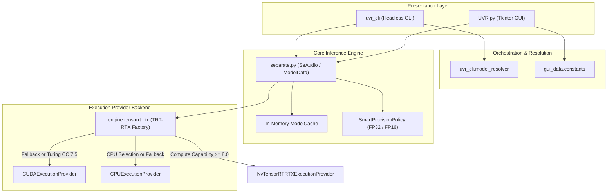

# Architecture & System Design

This document describes the codebase architecture, module responsibilities, execution provider lifecycle, and component boundaries of **RLD UVR-Opt**.

---

## 1. Directory Tree & Responsibilities

```text
RLD-UVR-Opt/
├── UVR.py                   # GUI presentation entry point (Tkinter layout, menus, event loop)
├── separate.py              # Core inference engine (MDX-Net, VR, Demucs processing & caching)
├── __version__.py           # Application VERSION and BUILD_ID metadata
├── run_uvr.bat              # Launcher batch script (activates venv and runs UVR.py via uv run)
├── engine/
│   └── tensorrt_rtx/        # TensorRT-RTX Execution Provider backend
│       ├── __init__.py      # Package export and provider constants
│       ├── environment.py   # GPU architecture check (CC >= 8.0) and DLL registration
│       └── session.py       # Session factory with automatic graceful fallback ladder
├── uvr_cli/                 # Headless command-line execution & benchmarking interface
│   ├── cli.py               # Argument parser and command dispatcher
│   ├── runner.py            # Headless model runner and audio loader bridge
│   ├── model_resolver.py   # Model metadata discovery and parameter resolution
│   ├── engine.py            # Multi-round benchmark coordinator
│   ├── telemetry.py         # Hardware telemetry sampler (pynvml, psutil, PyTorch VRAM)
│   └── exporter.py          # CSV and JSON result serializer
├── gui_data/                # GUI configuration, constants, themes, and model parameters
│   └── constants.py         # Execution Provider names, choices, and UI strings
├── install/                 # 5-phase modular installer pipeline
│   ├── Install-UVR.ps1      # PowerShell orchestrator
│   ├── install_packages.bat # Thin launcher for Install-UVR.ps1
│   ├── lib/                 # Pipeline phases (Config, Detect, Plan, Verify, Install, Validate, Record)
│   ├── reqs/                # Stack requirements (requirements.txt, requirements_trt_rtx.txt, ...)
│   ├── tests/               # Pester unit tests for installer planning and verification gates
│   └── wheels/              # Pre-compiled Windows x64 binary wheels (diffq)
├── tests/                   # Automated unit tests for CLI, cache, TRT, and batch files
└── benchmark_results/       # Performance datasets, CSV summaries, and per-round session logs
```

---

## 2. High-Level Architecture Diagram



---

## 3. Execution Provider Selection & Fallback Ladder

RLD UVR-Opt supports three Execution Providers (EP) in ONNX Runtime:
1. **`NvTensorRTRTXExecutionProvider`** (`trt_rtx`): Accelerated TensorRT runtime for RTX 30/40/50-series (Ampere+ / CC $\ge 8.0$).
2. **`CUDAExecutionProvider`** (`cuda`): Standard CUDA provider for NVIDIA GPUs (Turing RTX 20+ / CC $\ge 7.5$).
3. **`CPUExecutionProvider`** (`cpu`): Universal CPU execution using OpenMP/MKL thread pools.

### Provider Resolution Ladder

When TensorRT-RTX is requested, the session factory ([engine/tensorrt_rtx/session.py](../../engine/tensorrt_rtx/session.py)) executes an explicit fallback chain:

```text
[Request: TensorRT-RTX]
         │
         ├──► 1. Check Hardware (Compute Capability >= 8.0)
         │       └── If False: Fall back to CUDAExecutionProvider immediately.
         │
         ├──► 2. Standalone EP ABI Plugin (onnxruntime-ep-nv-tensorrt-rtx)
         │       └── Query ort.get_ep_devices() -> build SessionOptions with TRT config.
         │
         ├──► 3. Built-in NvTensorRTRTXExecutionProvider
         │       └── If plugin device absent, attempt built-in provider symbol.
         │
         ├──► 4. Stable CUDA Fallback
         │       └── If TensorRT engine creation fails, fall back to CUDAExecutionProvider.
         │
         └──► 5. Safe CPU Fallback
                 └── If GPU runtime is missing, evaluate on CPUExecutionProvider.
```

### No Silent Fallback Rule
A common pitfall in ONNX Runtime is silent fallback: when a requested Execution Provider fails to load internal dependencies, ONNX Runtime may quietly fall back to CPU without throwing an exception.

In RLD UVR-Opt:
- All session factories inspect `session.get_providers()` immediately after instantiation.
- Active providers are logged explicitly to the terminal/logging pipeline:
  ```python
  active_provider = session.get_providers()[0]
  print(f"[BACKEND] Active execution provider: {active_provider}")
  ```
- If a fallback occurs (e.g. from TensorRT-RTX to CUDA), a warning is logged so telemetry and benchmark recordings never record a fallback as an accelerated run.

---

## 4. Component Boundaries & Pipeline Decoupling

To ensure testability and headless execution:

1. **Decoupled Computation**:
   - `separate.py`, `engine/tensorrt_rtx/`, and `uvr_cli/` must never import Tkinter or reference GUI widgets (`root`, `ttk.Entry`, etc.).
   - Progress reporting uses standard callbacks: `write_progress(value: float, message: str)`.

2. **In-Memory Model Caching**:
   - `separate.py` maintains an in-memory resident cache (`ModelCache`) to avoid reloading heavy ONNX graphs when running repeated chunks or identical models across tracks.
   - Cache keys consist of `(model_path, precision, device)`. If precision or device changes, the cache evicts previous handles safely to prevent VRAM fragmentation.

3. **In-Memory FP16 Downcasting**:
   - When Performance (FP16) mode is enabled on FP32 models, `onnxconverter_common.convert_float_to_float16` converts graphs entirely in system memory.
   - Converted bytes are passed directly to `ort.InferenceSession` as an in-memory byte buffer without writing temporary `.fp16.onnx` files to disk.
